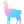

# AI

41 icons from AI model, inference, framework and coding-tool logos, mostly from [lobehub/lobe-icons](https://github.com/lobehub/lobe-icons) (MIT; URLs in [`SOURCES.txt`](SOURCES.txt)), packaged as a Miro-style Excalidraw library:
each item is a 64px icon with an editable label below it, grouped together.

<table>
<tr><td align="center" width="120"> OpenAI</td><td align="center" width="120"> Anthropic</td><td align="center" width="120"> Claude</td><td align="center" width="120"> Google Gemini</td><td align="center" width="120"> Mistral AI</td><td align="center" width="120"> Meta Llama</td></tr>
<tr><td align="center" width="120"> DeepSeek</td><td align="center" width="120"> Qwen</td><td align="center" width="120"> xAI</td><td align="center" width="120"> Hugging Face</td><td align="center" width="120"> Ollama</td><td align="center" width="120"> vLLM</td></tr>
<tr><td align="center" width="120"> OpenRouter</td><td align="center" width="120"> Groq</td><td align="center" width="120"> Vertex AI</td><td align="center" width="120"> LangChain</td><td align="center" width="120"> LangGraph</td><td align="center" width="120"> LlamaIndex</td></tr>
<tr><td align="center" width="120"> Model Context Protocol</td><td align="center" width="120"> Langfuse</td><td align="center" width="120"> n8n</td><td align="center" width="120"> GitHub Copilot</td><td align="center" width="120"> Cursor</td><td align="center" width="120"> Claude Code</td></tr>
</table>

24 of 41 shown. Every icon is in [`icons/`](icons/).

## Use

Build with `uv run build.py` from the repo root, then in Excalidraw:

1. Open `ai.excalidraw` (or paste icons from it into your drawing), so the images are loaded.
2. Import `ai.excalidrawlib` from the library panel.

Excalidraw doesn't store images in library files, so library icons render only once the
drawing contains them. See the [main README](../README.md).

<!-- Generated by build.py; edit pack.yml instead. -->
