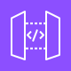

# AWS Architecture Icons

810 icons from [AWS Architecture Icons](https://aws.amazon.com/architecture/icons/), packaged as a Miro-style Excalidraw library:
each item is a 64px icon with an editable label below it, grouped together.

<table>
<tr><td align="center" width="120"> Amazon EC2</td><td align="center" width="120"> AWS Lambda</td><td align="center" width="120"> Amazon Simple Storage Service</td><td align="center" width="120"> Amazon RDS</td><td align="center" width="120"> Amazon Aurora</td><td align="center" width="120"> Amazon DynamoDB</td></tr>
<tr><td align="center" width="120"> Amazon ElastiCache</td><td align="center" width="120"> Amazon CloudFront</td><td align="center" width="120"> Amazon Virtual Private Cloud</td><td align="center" width="120"> Amazon Route 53</td><td align="center" width="120"> Elastic Load Balancing</td><td align="center" width="120"> Amazon API Gateway</td></tr>
<tr><td align="center" width="120"> Amazon Simple Queue Service</td><td align="center" width="120"> Amazon Simple Notification Service</td><td align="center" width="120"> Amazon EventBridge</td><td align="center" width="120"> AWS Step Functions</td><td align="center" width="120"> Amazon Elastic Container Service</td><td align="center" width="120"> Amazon Elastic Kubernetes Service</td></tr>
<tr><td align="center" width="120"> AWS Fargate</td><td align="center" width="120"> Amazon CloudWatch</td><td align="center" width="120"> AWS Identity And Access Management</td><td align="center" width="120"> Amazon Kinesis</td><td align="center" width="120"> Amazon SageMaker</td><td align="center" width="120"> Amazon Bedrock</td></tr>
</table>

24 of 810 shown. Every icon is in [`src/`](src/).

## Sources

Paths are relative to [`src/`](src/). Imported files are refreshed by
`uv run build.py --import aws`; the rest are kept by hand.

| Files | Source | Notes |
| ----- | ------ | ----- |
| `**` | https://d1.awsstatic.com/onedam/marketing-channels/website/public/shared/architecture-icon-release/Icon-package_07312026.5846e92413caa21490223536cc97f1269e44fa92.zip | largest size of each icon, white-only ones skipped |

## Use

Build with `uv run build.py` from the repo root, then in Excalidraw:

1. Open `runax-aws.excalidraw` (or paste icons from it into your drawing), so the images are loaded.
2. Import `runax-aws.excalidrawlib` from the library panel.

Excalidraw doesn't store images in library files, so library icons render only once the
drawing contains them. See the [main README](../README.md).

<!-- Generated by build.py; edit pack.yml instead. -->
