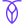
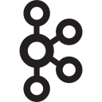
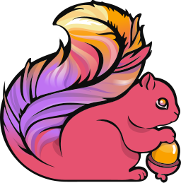

# Data

34 icons from database, streaming and data-pipeline logos (URLs in [`SOURCES.txt`](SOURCES.txt)), packaged as a Miro-style Excalidraw library:
each item is a 64px icon with an editable label below it, grouped together.

<table>
<tr><td align="center" width="120"> PostgreSQL</td><td align="center" width="120"> MySQL</td><td align="center" width="120"> Microsoft SQL Server</td><td align="center" width="120"> SQLite</td><td align="center" width="120"> ClickHouse</td><td align="center" width="120"> DuckDB</td></tr>
<tr><td align="center" width="120"> CockroachDB</td><td align="center" width="120"> Snowflake</td><td align="center" width="120"> MongoDB</td><td align="center" width="120"> Redis</td><td align="center" width="120"> Valkey</td><td align="center" width="120"> Neo4j</td></tr>
<tr><td align="center" width="120"> Apache Kafka</td><td align="center" width="120"> RabbitMQ</td><td align="center" width="120"> NATS</td><td align="center" width="120"> MQTT</td><td align="center" width="120"> Apache ActiveMQ</td><td align="center" width="120"> BullMQ</td></tr>
<tr><td align="center" width="120"> Apache Flink</td><td align="center" width="120"> Apache Spark</td><td align="center" width="120"> Apache Airflow</td><td align="center" width="120"> Apache Iceberg</td><td align="center" width="120"> Airbyte</td><td align="center" width="120"> Apache SeaTunnel</td></tr>
<tr><td align="center" width="120"> dbt</td><td align="center" width="120"> Qdrant</td><td align="center" width="120"> OpenSearch</td></tr>
</table>

27 of 34 shown. Every icon is in [`icons/`](icons/).

## Use

Build with `uv run build.py` from the repo root, then in Excalidraw:

1. Open `data.excalidraw` (or paste icons from it into your drawing), so the images are loaded.
2. Import `data.excalidrawlib` from the library panel.

Excalidraw doesn't store images in library files, so library icons render only once the
drawing contains them. See the [main README](../README.md).

<!-- Generated by build.py; edit pack.yml instead. -->
