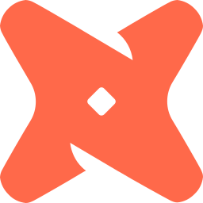
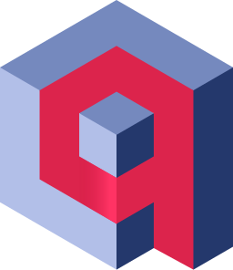

# Data

33 icons from database, streaming and data-pipeline logos, packaged as a Miro-style Excalidraw library:
each item is a 64px icon with an editable label below it, grouped together.

<table>
<tr><td align="center" width="120"> PostgreSQL</td><td align="center" width="120"> MySQL</td><td align="center" width="120"> SQLite</td><td align="center" width="120"> ClickHouse</td><td align="center" width="120"> DuckDB</td><td align="center" width="120"> CockroachDB</td></tr>
<tr><td align="center" width="120"> Snowflake</td><td align="center" width="120"> MongoDB</td><td align="center" width="120"> Redis</td><td align="center" width="120"> Valkey</td><td align="center" width="120"> Neo4j</td><td align="center" width="120"> Apache Kafka</td></tr>
<tr><td align="center" width="120"> RabbitMQ</td><td align="center" width="120"> NATS</td><td align="center" width="120"> MQTT</td><td align="center" width="120"> Apache ActiveMQ</td><td align="center" width="120"> BullMQ</td><td align="center" width="120"> Apache Flink</td></tr>
<tr><td align="center" width="120"> Apache Spark</td><td align="center" width="120"> Apache Airflow</td><td align="center" width="120"> Apache Iceberg</td><td align="center" width="120"> Airbyte</td><td align="center" width="120"> Apache SeaTunnel</td><td align="center" width="120"> dbt</td></tr>
<tr><td align="center" width="120"> Qdrant</td><td align="center" width="120"> OpenSearch</td></tr>
</table>

26 of 33 shown. Every icon is in [`src/`](src/). Changes are in [`CHANGELOG.md`](CHANGELOG.md).

## License

Logos come from the projects themselves, [gilbarbara/logos](https://github.com/gilbarbara/logos) (CC0-1.0) and [simple-icons](https://github.com/simple-icons/simple-icons) (CC0-1.0). Product names and logos are trademarks of their owners and are used here only to refer to their products; no endorsement is implied.

This pack forbids, and the build refuses:

- `native`: redrawing changes the logos' shape; the logos are their owners' trademarks
- `publish`: the logos are their owners' trademarks; we don't republish them as a library of their own

## Sources

Imports last fetched 2026-11-15. Paths are relative to [`src/`](src/). Imported files are refreshed by
`uv run runax-icons import data`; the rest are kept by hand.

| Files | Source | Notes |
| ----- | ------ | ----- |
| `*.svg` | https://raw.githubusercontent.com/gilbarbara/logos/main/logos/{src}.svg | CC0-1.0; 8 files |
| `ClickHouse.svg` | https://raw.githubusercontent.com/ClickHouse/ClickHouse/master/docker/server/README.src/logo.svg |  |
| `DuckDB.svg` | https://raw.githubusercontent.com/duckdb/duckdb-web/main/images/designmanual/DuckDB_icon-lightmode.svg | the icon from DuckDB's design manual |
| `Neo4j.svg` | https://raw.githubusercontent.com/simple-icons/simple-icons/develop/icons/neo4j.svg | CC0-1.0; Neo4j brand color (the neo4j-browser icon is GPL-3.0); filled #4581C3 |
| `Apache-Iceberg.svg` | https://raw.githubusercontent.com/apache/iceberg/main/site/docs/assets/images/iceberg-logo-icon.png | PNG wrapped in SVG |
| `Apache-SeaTunnel.svg` | https://seatunnel.apache.org/image/logo.png | PNG wrapped in SVG |
| `Apache-ActiveMQ.svg` | https://raw.githubusercontent.com/apache/activemq-website/main/src/assets/img/activemq_logo_icon.svg | viewBox cropped |
| `Apache-NiFi.svg` | https://raw.githubusercontent.com/apache/nifi-site/main/themes/nifi/static/images/apache-nifi-drop-logo.svg | the drop mark from the NiFi website |
| `MQTT.svg` | https://raw.githubusercontent.com/mqtt/mqtt.org/master/assets/img/mqtt-ver.svg | official logo, unmodified (mqtt.org has no symbol-only version) |
| `BullMQ.svg` | https://user-images.githubusercontent.com/95200/143832033-32e868df-f3b0-4251-97fb-c64809a43d36.png | the taskforcesh/bullmq README banner, unmodified (BullMQ has no other logo file) |
| `CockroachDB.svg` | https://raw.githubusercontent.com/simple-icons/simple-icons/develop/icons/cockroachlabs.svg | Cockroach Labs brand color; filled #6933FF |
| `*.svg` | https://raw.githubusercontent.com/gilbarbara/logos/main/logos/{src}.svg | CC0-1.0; 15 files |

## Use

Build with `uv run runax-icons build` from the repo root, then in Excalidraw:

1. Open `runax-data.excalidraw` (or paste icons from it into your drawing), so the images are loaded.
2. Import `runax-data.excalidrawlib` from the library panel.

Excalidraw doesn't store images in library files, so library icons render only once the
drawing contains them. See the [main README](../README.md).

<!-- Generated by runax-icons build; edit pack.yml instead. -->
