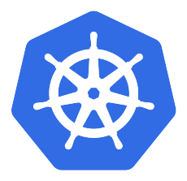

# Kubernetes Icons

44 icons from [kubernetes/community `icons/svg`](https://github.com/kubernetes/community/tree/main/icons/svg) plus the Kubernetes, Argo CD, Helm, K3s and K3OS logos (URLs in [`SOURCES.txt`](SOURCES.txt)), packaged as a Miro-style Excalidraw library:
each item is a 64px icon with an editable label below it, grouped together.

<table>
<tr><td align="center" width="120"> Kubernetes</td><td align="center" width="120"> Helm</td><td align="center" width="120"> Argo CD</td><td align="center" width="120"> Pod</td><td align="center" width="120"> Deployment</td><td align="center" width="120"> ReplicaSet</td></tr>
<tr><td align="center" width="120"> StatefulSet</td><td align="center" width="120"> DaemonSet</td><td align="center" width="120"> Job</td><td align="center" width="120"> CronJob</td><td align="center" width="120"> Service</td><td align="center" width="120"> Ingress</td></tr>
<tr><td align="center" width="120"> NetworkPolicy</td><td align="center" width="120"> ConfigMap</td><td align="center" width="120"> Secret</td><td align="center" width="120"> PersistentVolume</td><td align="center" width="120"> PersistentVolumeClaim</td><td align="center" width="120"> StorageClass</td></tr>
<tr><td align="center" width="120"> Namespace</td><td align="center" width="120"> ServiceAccount</td><td align="center" width="120"> Role</td><td align="center" width="120"> RoleBinding</td><td align="center" width="120"> HorizontalPodAutoscaler</td><td align="center" width="120"> Node</td></tr>
<tr><td align="center" width="120"> Control Plane</td><td align="center" width="120"> API Server</td><td align="center" width="120"> etcd</td></tr>
</table>

27 of 44 shown. Every icon is in [`icons/`](icons/).

## Use

Build with `uv run build.py` from the repo root, then in Excalidraw:

1. Open `k8s.excalidraw` (or paste icons from it into your drawing), so the images are loaded.
2. Import `k8s.excalidrawlib` from the library panel.

Excalidraw doesn't store images in library files, so library icons render only once the
drawing contains them. See the [main README](../README.md).

<!-- Generated by build.py; edit pack.yml instead. -->
