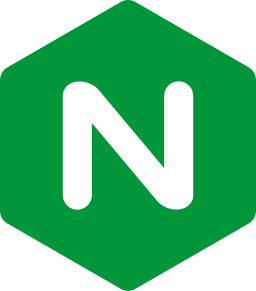
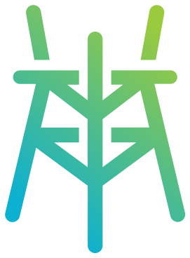

# Networking

35 icons from service mesh, ingress, CNI, DNS, VPN and API protocol logos: CNCF projects from [cncf/artwork](https://github.com/cncf/artwork) plus NGINX, Traefik, Kong, HAProxy, Caddy, Calico, Consul, Tailscale, WireGuard, NetBird, GraphQL, REST, OpenAPI, Swagger and Socket.IO (URLs in [`SOURCES.txt`](SOURCES.txt)), packaged as a Miro-style Excalidraw library:
each item is a 64px icon with an editable label below it, grouped together.

<table>
<tr><td align="center" width="120"> Istio</td><td align="center" width="120"> Linkerd</td><td align="center" width="120"> Cilium</td><td align="center" width="120"> Envoy</td><td align="center" width="120"> NGINX</td><td align="center" width="120"> Traefik</td></tr>
<tr><td align="center" width="120"> Kong</td><td align="center" width="120"> HAProxy</td><td align="center" width="120"> Caddy</td><td align="center" width="120"> Contour</td><td align="center" width="120"> Emissary-ingress</td><td align="center" width="120"> kgateway</td></tr>
<tr><td align="center" width="120"> Kuma</td><td align="center" width="120"> HashiCorp Consul</td><td align="center" width="120"> Calico</td><td align="center" width="120"> Antrea</td><td align="center" width="120"> MetalLB</td><td align="center" width="120"> CoreDNS</td></tr>
<tr><td align="center" width="120"> cert-manager</td><td align="center" width="120"> SPIFFE</td><td align="center" width="120"> SPIRE</td><td align="center" width="120"> gRPC</td><td align="center" width="120"> GraphQL</td><td align="center" width="120"> REST API</td></tr>
<tr><td align="center" width="120"> OpenAPI</td><td align="center" width="120"> Swagger</td><td align="center" width="120"> Socket.IO</td><td align="center" width="120"> Tailscale</td><td align="center" width="120"> WireGuard</td><td align="center" width="120"> NetBird</td></tr>
</table>

30 of 35 shown. Every icon is in [`icons/`](icons/).

## Use

Build with `uv run build.py` from the repo root, then in Excalidraw:

1. Open `networking.excalidraw` (or paste icons from it into your drawing), so the images are loaded.
2. Import `networking.excalidrawlib` from the library panel.

Excalidraw doesn't store images in library files, so library icons render only once the
drawing contains them. See the [main README](../README.md).

<!-- Generated by build.py; edit pack.yml instead. -->
