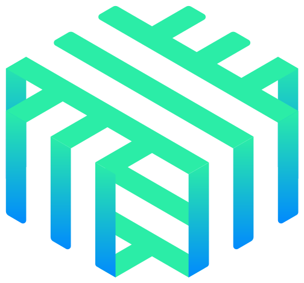
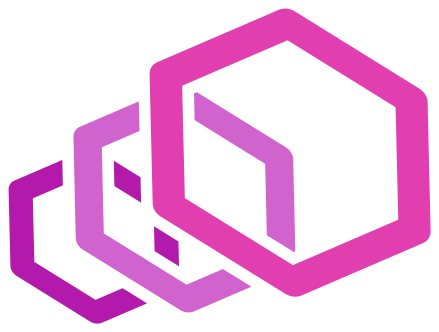
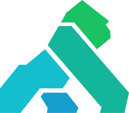
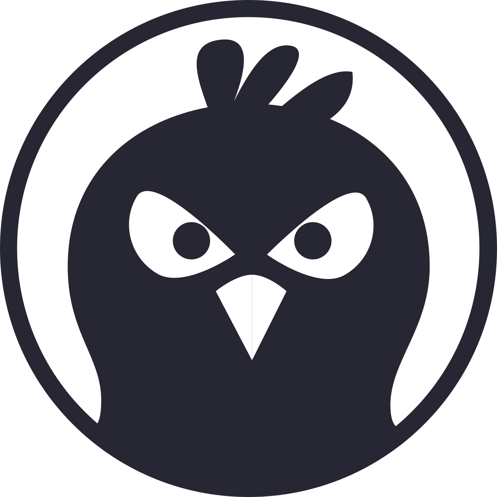
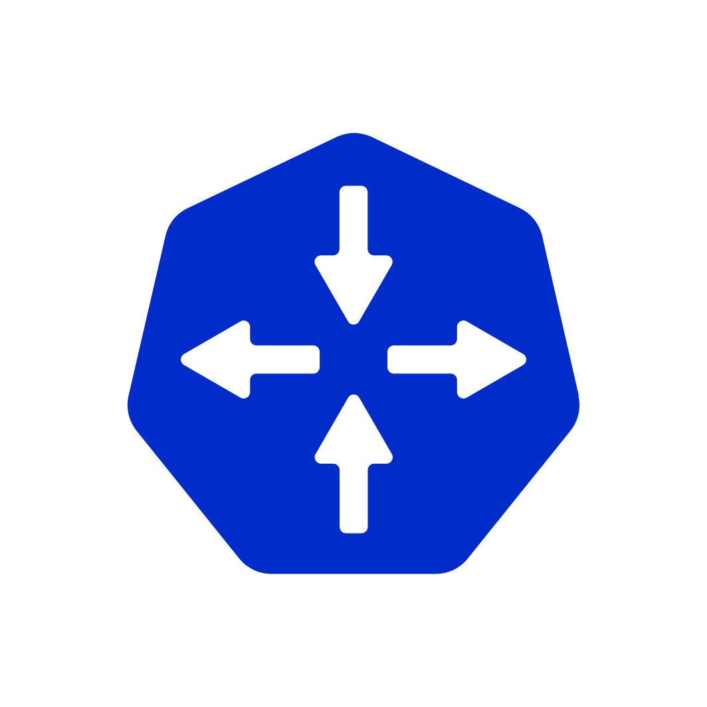
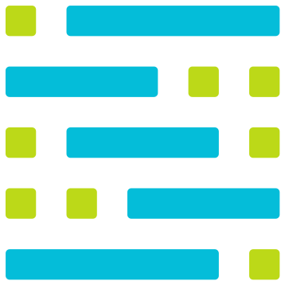
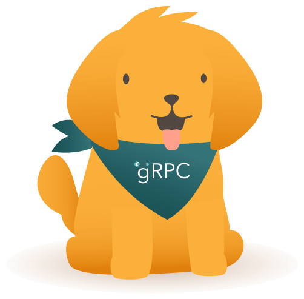
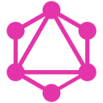
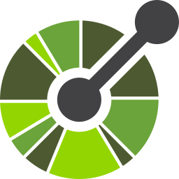
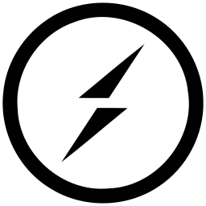

# Networking

35 icons from service mesh, ingress, CNI, DNS, VPN and API protocol logos: CNCF projects from [cncf/artwork](https://github.com/cncf/artwork) plus NGINX, Traefik, Kong, HAProxy, Caddy, Calico, Consul, Tailscale, WireGuard, NetBird, GraphQL, REST, OpenAPI, Swagger and Socket.IO, packaged as a Miro-style Excalidraw library:
each item is a 64px icon with an editable label below it, grouped together.

<table>
<tr><td align="center" width="120"> Istio</td><td align="center" width="120"> Linkerd</td><td align="center" width="120"> Cilium</td><td align="center" width="120"> Envoy</td><td align="center" width="120"> NGINX</td><td align="center" width="120"> Traefik</td></tr>
<tr><td align="center" width="120"> Kong</td><td align="center" width="120"> HAProxy</td><td align="center" width="120"> Caddy</td><td align="center" width="120"> Contour</td><td align="center" width="120"> Emissary-ingress</td><td align="center" width="120"> kgateway</td></tr>
<tr><td align="center" width="120"> Kuma</td><td align="center" width="120"> HashiCorp Consul</td><td align="center" width="120"> Calico</td><td align="center" width="120"> Antrea</td><td align="center" width="120"> MetalLB</td><td align="center" width="120"> CoreDNS</td></tr>
<tr><td align="center" width="120"> cert-manager</td><td align="center" width="120"> SPIFFE</td><td align="center" width="120"> SPIRE</td><td align="center" width="120"> gRPC</td><td align="center" width="120"> GraphQL</td><td align="center" width="120"> REST API</td></tr>
<tr><td align="center" width="120"> OpenAPI</td><td align="center" width="120"> Swagger</td><td align="center" width="120"> Socket.IO</td><td align="center" width="120"> Tailscale</td><td align="center" width="120"> WireGuard</td><td align="center" width="120"> NetBird</td></tr>
</table>

30 of 35 shown. Every icon is in [`src/`](src/). Changes are in [`CHANGELOG.md`](CHANGELOG.md).

## License

The CNCF project logos are from [cncf/artwork](https://github.com/cncf/artwork), used under the [Linux Foundation trademark guidelines](https://www.linuxfoundation.org/legal/trademark-usage); other logos come from [gilbarbara/logos](https://github.com/gilbarbara/logos) (CC0-1.0), [simple-icons](https://github.com/simple-icons/simple-icons) (CC0-1.0) or the projects themselves. Product names and logos are trademarks of their owners and are used here only to refer to their products; no endorsement is implied.

## Sources

Imports last fetched 2026-11-15. Paths are relative to [`src/`](src/). Imported files are refreshed by
`uv run runax-icons import networking`; the rest are kept by hand.

| Files | Source | Notes |
| ----- | ------ | ----- |
| `cncf/*.svg` | https://raw.githubusercontent.com/cncf/artwork/main/projects/{name}/icon/color/{name}-icon-color.svg | 17 files |
| `cncf/cilium.svg` | https://raw.githubusercontent.com/cncf/artwork/main/projects/cilium/icon/color/cilium_icon-color.svg |  |
| `cncf/kmesh.svg` | https://raw.githubusercontent.com/cncf/artwork/main/projects/kmesh/icon/color/KMESH-icon-color.svg |  |
| `cncf/grpc.svg` | https://raw.githubusercontent.com/cncf/artwork/main/projects/grpc/pancake/color/grpc-pancake-color.svg | the gRPC mascot; its icon/ file is the wordmark |
| `other/*.svg` | https://raw.githubusercontent.com/gilbarbara/logos/main/logos/{src}.svg | CC0-1.0; 5 files |
| `other/haproxy.svg` | https://raw.githubusercontent.com/simple-icons/simple-icons/develop/icons/haproxy.svg | HAProxy brand color; filled #169BD6 |
| `other/caddy.svg` | https://caddyserver.com/resources/images/logo-light.svg | mark only; viewBox cropped |
| `other/calico.svg` | https://www.tigera.io/app/uploads/2026/01/Calico-logo-2026-black-text.svg | mark only; viewBox cropped |
| `other/wireguard.svg` | https://www.wireguard.com/img/wireguard.svg | mark only; viewBox cropped |
| `other/netbird.svg` | https://raw.githubusercontent.com/netbirdio/netbird/main/client/ui/frontend/src/assets/logos/netbird.svg |  |
| `other/rest.svg` |  | drawn for this pack; REST has no logo |
| `other/*` |  | moved from the techno pack (originally from techno's svg.zip) (GraphQL, OpenAPI, Swagger, Socket.IO) |

## Use

Build with `uv run runax-icons build` from the repo root, then in Excalidraw:

1. Open `runax-networking.excalidraw` (or paste icons from it into your drawing), so the images are loaded.
2. Import `runax-networking.excalidrawlib` from the library panel.

Excalidraw doesn't store images in library files, so library icons render only once the
drawing contains them. See the [main README](../README.md).

<!-- Generated by runax-icons build; edit pack.yml instead. -->
