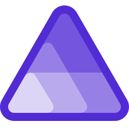
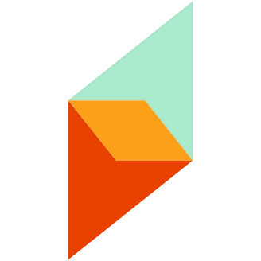

# Observability

27 icons from [grafana.com](https://grafana.com/oss/) product logos and signal icons, plus [OpenTelemetry](https://opentelemetry.io), [Prometheus](https://prometheus.io), [.NET Aspire](https://aspire.dev), [Seq](https://datalust.co/seq) and [PostHog](https://posthog.com), packaged as a Miro-style Excalidraw library:
each item is a 64px icon with an editable label below it, grouped together.

<table>
<tr><td align="center" width="120"> Logs</td><td align="center" width="120"> Metrics</td><td align="center" width="120"> Traces</td><td align="center" width="120"> Profiles</td><td align="center" width="120"> Alerts</td><td align="center" width="120"> Dashboards</td></tr>
<tr><td align="center" width="120"> Grafana</td><td align="center" width="120"> Grafana Loki</td><td align="center" width="120"> Grafana Tempo</td><td align="center" width="120"> Grafana Mimir</td><td align="center" width="120"> Grafana Pyroscope</td><td align="center" width="120"> Grafana Alloy</td></tr>
<tr><td align="center" width="120"> Grafana Beyla</td><td align="center" width="120"> Grafana Faro</td><td align="center" width="120"> Grafana k6</td><td align="center" width="120"> Grafana OnCall</td><td align="center" width="120"> Grafana Incident</td><td align="center" width="120"> Grafana SLO</td></tr>
<tr><td align="center" width="120"> Grafana Tanka</td><td align="center" width="120"> Graphite</td><td align="center" width="120"> Prometheus</td><td align="center" width="120"> Alertmanager</td><td align="center" width="120"> OpenTelemetry</td><td align="center" width="120"> OpenTelemetry Collector</td></tr>
<tr><td align="center" width="120"> .NET Aspire</td><td align="center" width="120"> Seq</td><td align="center" width="120"> PostHog</td></tr>
</table>

27 of 27 shown. Every icon is in [`src/`](src/). Changes are in [`CHANGELOG.md`](CHANGELOG.md).

## License

Logos come from grafana.com, the projects' own repositories and [cncf/artwork](https://github.com/cncf/artwork); the OpenTelemetry Collector icon is from [opentelemetry.io](https://github.com/open-telemetry/opentelemetry.io) (CC-BY-4.0). Product names and logos are trademarks of their owners and are used here only to refer to their products; no endorsement is implied.

This pack forbids, and the build refuses:

- `edit`: the logos are their owners' trademarks (Grafana's among them), used as published
- `publish`: the logos are their owners' trademarks; we don't republish them as a library of their own

## Sources

Imports last fetched 2026-11-15. Paths are relative to [`src/`](src/). Imported files are refreshed by
`uv run runax-icons import observability`; the rest are kept by hand.

| Files | Source | Notes |
| ----- | ------ | ----- |
| `grafana/grafana.svg` | https://grafana.com/oss/assets/logo-grafana-spiral.svg |  |
| `grafana/grafana-loki.svg` | https://grafana.com/oss/assets/logo-loki.svg |  |
| `grafana/grafana-tempo.svg` | https://grafana.com/oss/assets/logo-tempo.svg |  |
| `grafana/grafana-mimir.svg` | https://grafana.com/oss/assets/logo-mimir.svg |  |
| `grafana/grafana-pyroscope.svg` | https://grafana.com/static/img/pyroscope-logo.svg |  |
| `grafana/grafana-alloy.svg` | https://grafana.com/media/oss/alloy/alloy-logo.svg |  |
| `grafana/grafana-beyla.svg` | https://grafana.com/static/img/logos/beyla-logo.svg |  |
| `grafana/grafana-faro.svg` | https://grafana.com/oss/assets/logo-grafana-faro.svg |  |
| `grafana/grafana-k6.svg` | https://grafana.com/media/menus/products/grafana-menu-icon-k6.svg |  |
| `grafana/grafana-tanka.svg` | https://grafana.com/oss/assets/logo-grafana-tanka.svg |  |
| `grafana/graphite.svg` | https://grafana.com/oss/assets/logo-graphite.svg |  |
| `grafana/grafana-incident.svg` | https://grafana.com/static/img/logos/incident.svg |  |
| `grafana/grafana-slo.svg` | https://grafana.com/static/img/logos/slo.svg |  |
| `grafana/grafana-oncall.svg` | https://grafana.com/oss/assets/logo-grafana-oncall.svg |  |
| `signals/logs.svg` | https://a-us.storyblok.com/f/1022730/24x24/682285d5c0/icon-nav-logs.svg | grafana.com nav icon |
| `signals/metrics.svg` | https://a-us.storyblok.com/f/1022730/24x24/a6d277c5a5/icon-nav-metrics.svg | grafana.com nav icon |
| `signals/traces.svg` | https://a-us.storyblok.com/f/1022730/24x24/c0434948fc/icon-nav-traces.svg | grafana.com nav icon |
| `signals/profiles.svg` | https://a-us.storyblok.com/f/1022730/24x24/68d796c56c/icon-nav-profiles.svg | grafana.com nav icon |
| `signals/dashboards.svg` | https://a-us.storyblok.com/f/1022730/24x24/27416765d7/icon-nav-dashboards-data-visualization.svg | grafana.com nav icon |
| `signals/alerts.svg` | https://a-us.storyblok.com/f/1022730/32x32/a412179eca/grafana-pricing-icon-irm.svg | Grafana IRM icon, unmodified |
| `prometheus/*.svg` | https://raw.githubusercontent.com/prometheus/docs/main/public/assets/prometheus-logo.svg | Alertmanager has no logo of its own; 2 files |
| `opentelemetry/opentelemetry.svg` | https://raw.githubusercontent.com/cncf/artwork/main/projects/opentelemetry/icon/color/opentelemetry-icon-color.svg |  |
| `opentelemetry/opentelemetry-collector.svg` | https://raw.githubusercontent.com/open-telemetry/opentelemetry.io/main/iconography/32x32/Collector.svg |  |
| `aspire/aspire.svg` | https://raw.githubusercontent.com/dotnet/aspire/main/.agents/skills/create-video/scripts/assets/aspire-logo.svg |  |
| `posthog/posthog.svg` | https://raw.githubusercontent.com/PostHog/posthog/master/frontend/public/posthog-icon.svg |  |
| `seq/seq.svg` | https://datalust.co/favicon.png | Seq's own symbol (its site icon) |

## Use

Build with `uv run runax-icons build` from the repo root, then in Excalidraw:

1. Open `runax-observability.excalidraw` (or paste icons from it into your drawing), so the images are loaded.
2. Import `runax-observability.excalidrawlib` from the library panel.

Excalidraw doesn't store images in library files, so library icons render only once the
drawing contains them. See the [main README](../README.md).

<!-- Generated by runax-icons build; edit pack.yml instead. -->
