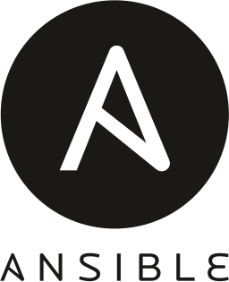
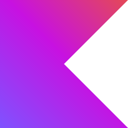

# Technology Logos

73 icons from hand-picked technology logos from [gilbarbara/logos](https://github.com/gilbarbara/logos) and [simple-icons](https://github.com/simple-icons/simple-icons), packaged as a Miro-style Excalidraw library:
each item is a 64px icon with an editable label below it, grouped together.

<table>
<tr><td align="center" width="120"> Docker</td><td align="center" width="120"> HashiCorp Terraform</td><td align="center" width="120"> Ansible</td><td align="center" width="120"> GitHub</td><td align="center" width="120"> GitHub Actions</td><td align="center" width="120"> GitLab</td></tr>
<tr><td align="center" width="120"> Python</td><td align="center" width="120"> Go</td><td align="center" width="120"> TypeScript</td><td align="center" width="120"> Rust</td><td align="center" width="120"> Java</td><td align="center" width="120"> React</td></tr>
<tr><td align="center" width="120"> Next.js</td><td align="center" width="120"> Node.js</td><td align="center" width="120"> Spring</td><td align="center" width="120"> Vue.js</td><td align="center" width="120"> Angular</td><td align="center" width="120"> Linux</td></tr>
<tr><td align="center" width="120"> Ubuntu</td><td align="center" width="120"> Bash</td><td align="center" width="120"> Kotlin</td><td align="center" width="120"> Swift</td><td align="center" width="120"> Figma</td></tr>
</table>

23 of 73 shown. Every icon is in [`src/`](src/). Changes are in [`CHANGELOG.md`](CHANGELOG.md).

## License

The logos come from [gilbarbara/logos](https://github.com/gilbarbara/logos) and [simple-icons](https://github.com/simple-icons/simple-icons) (both CC0-1.0); GitHub Codespaces is from [Primer Octicons](https://github.com/primer/octicons) (MIT). Product names and logos are trademarks of their owners and are used here only to refer to their products; no endorsement is implied.

This pack forbids, and the build refuses:

- `native`: redrawing changes the logos' shape; the logos are their owners' trademarks
- `publish`: the logos are their owners' trademarks; we don't republish them as a library of their own

## Sources

Imports last fetched 2026-11-15. Paths are relative to [`src/`](src/). Imported files are refreshed by
`uv run runax-icons import techno`; the rest are kept by hand.

| Files | Source | Notes |
| ----- | ------ | ----- |
| `*.svg` | https://raw.githubusercontent.com/gilbarbara/logos/main/logos/{src}.svg | CC0-1.0; 69 files |
| `CSS.svg` | https://raw.githubusercontent.com/gilbarbara/logos/main/logos/css.svg | CC0-1.0; the current CSS logo |
| `Elixir.svg` | https://raw.githubusercontent.com/simple-icons/simple-icons/develop/icons/elixir.svg | CC0-1.0; brand color; filled #8847B9 |
| `GitHub-Codespaces.svg` | https://raw.githubusercontent.com/primer/octicons/main/icons/codespaces-24.svg | Primer Octicons, MIT |
| `LLVM.svg` | https://raw.githubusercontent.com/simple-icons/simple-icons/develop/icons/llvm.svg | CC0-1.0; brand color; filled #262D3A |

## Use

Build with `uv run runax-icons build` from the repo root, then in Excalidraw:

1. Open `runax-techno.excalidraw` (or paste icons from it into your drawing), so the images are loaded.
2. Import `runax-techno.excalidrawlib` from the library panel.

Excalidraw doesn't store images in library files, so library icons render only once the
drawing contains them. See the [main README](../README.md).

<!-- Generated by runax-icons build; edit pack.yml instead. -->
