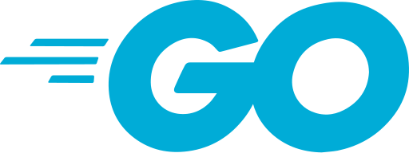
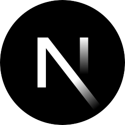
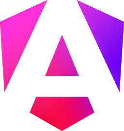

# Technology Logos

80 icons from hand-picked technology logos, packaged as a Miro-style Excalidraw library:
each item is a 64px icon with an editable label below it, grouped together.

<table>
<tr><td align="center" width="120"> Docker</td><td align="center" width="120"> HashiCorp Terraform</td><td align="center" width="120"> Ansible</td><td align="center" width="120"> GitHub</td><td align="center" width="120"> GitHub Actions</td><td align="center" width="120"> GitLab</td></tr>
<tr><td align="center" width="120"> Python</td><td align="center" width="120"> Go</td><td align="center" width="120"> TypeScript</td><td align="center" width="120"> Rust</td><td align="center" width="120"> Java</td><td align="center" width="120"> React</td></tr>
<tr><td align="center" width="120"> Next.js</td><td align="center" width="120"> Node.js</td><td align="center" width="120"> Spring</td><td align="center" width="120"> Vue.js</td><td align="center" width="120"> Angular</td><td align="center" width="120"> Linux</td></tr>
<tr><td align="center" width="120"> Ubuntu</td><td align="center" width="120"> Bash</td><td align="center" width="120"> Kotlin</td><td align="center" width="120"> Swift</td><td align="center" width="120"> Figma</td></tr>
</table>

23 of 80 shown. Every icon is in [`src/`](src/).

## Sources

Paths are relative to [`src/`](src/). Imported files are refreshed by
`uv run build.py --import techno`; the rest are kept by hand.

| Files | Source | Notes |
| ----- | ------ | ----- |
| `*` |  | hand-picked from a downloaded svg.zip of technology logos (kept in techno/downloads/, git-ignored) |

## Use

Build with `uv run build.py` from the repo root, then in Excalidraw:

1. Open `runax-techno.excalidraw` (or paste icons from it into your drawing), so the images are loaded.
2. Import `runax-techno.excalidrawlib` from the library panel.

Excalidraw doesn't store images in library files, so library icons render only once the
drawing contains them. See the [main README](../README.md).

<!-- Generated by build.py; edit pack.yml instead. -->
